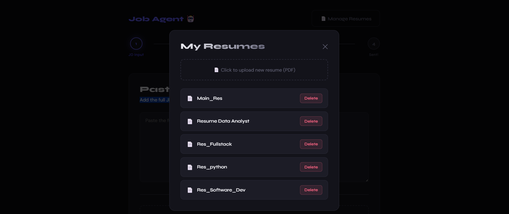
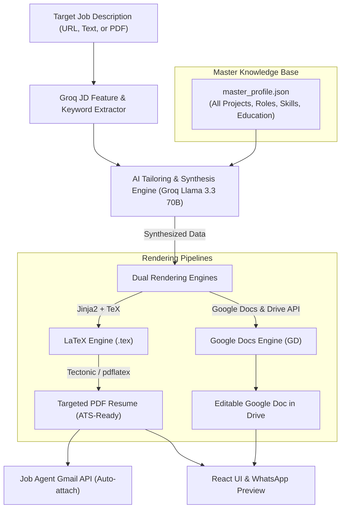

# 🤖 Job Agent — AI-Powered Job Application Automation

A full-stack, personal AI job application agent that reads job postings from **web links (LinkedIn, Instagram, career sites)**, **uploaded PDFs**, or **pasted text**, matches your best resume using **RAG (FAISS)**, generates tailored cover emails, and sends them directly through your **Gmail** with your resume attached — all in one click or directly via **WhatsApp**!

---

## ✨ Features

- 🔗 **Smart Link Scraper** — Paste any job posting link (LinkedIn job, LinkedIn post, Instagram hiring reel/post, or generic career site); AI extracts the role, company, and HR contact automatically.
- 💬 **WhatsApp AI Agent** — Apply directly on the go! Send a job link or text to your Twilio WhatsApp bot, pick a matched resume, review the draft, and reply `YES` to send.
- 📋 **Multi-Modal JD Ingestion** — Paste text, upload a PDF job description, or input URLs directly.
- 🧠 **Smart Resume Matching (RAG)** — Indexes your resumes with HuggingFace embeddings & FAISS vector search, then scores and ranks match percentages with Groq LLM.
- ✉️ **Tailored Email Writer** — Generates personalized, professional emails formatted in clean HTML with your contact info and portfolio links.
- 📎 **Auto PDF Attachment** — Automatically attaches your selected resume PDF and sends the email via the official Gmail API.
- 📁 **Resume Manager UI** — Upload new resume PDFs and delete old ones directly from the web interface, with automatic background vector indexing.
- ☁️ **Cloud Deployment Ready** — Includes `render.yaml` for seamless 1-click full-stack deployment on Render (FastAPI + React static site) with headless token support.

---

## 🖥️ UI Walkthrough

### 1. Job Description Input (Link / Text / PDF)


### 2. Resume Matching Step (AI Ranked)


### 3. Email Preview & Customization


### 4. Success Confirmation


### 5. Final Sent Email in Gmail


### 6. Manage Resumes Modal


---

## 📱 WhatsApp Agent in Action

You can apply to jobs directly from your smartphone without opening a browser:

```
User:       [Sends LinkedIn or Instagram Job Link]
Job Agent:  🤖 Resumes Matched!
            🏢 Company: TechCorp
            💼 Role: Full Stack Engineer
            📧 HR Email: careers@techcorp.com

            [ 1 ] 📄 resume_fullstack (92% match) — Strong React & Python skills
            [ 2 ] 📄 resume_backend (81% match) — API and database experience

            👉 Reply 1 or 2 to pick a resume
            👉 Or reply AUTO to use [ 1 ]

User:       AUTO
Job Agent:  ✉️ Email Draft Generated with [resume_fullstack]!
            📌 Subject: Application for Full Stack Engineer - Manikandan M
            📝 Preview: Dear Hiring Team, I am writing to express my strong interest...
            👉 Reply YES to send this email via Gmail
            👉 Reply RESUME to pick a different resume

User:       YES
Job Agent:  🎉 Application Sent Successfully!
            Attached Resume: resume_fullstack.pdf sent to careers@techcorp.com
```

---

## 🔧 Tech Stack

| Layer | Technology | Description |
|---|---|---|
| **Frontend** | React.js | Dynamic UI with tabbed inputs, progress tracking & resume management |
| **Backend** | FastAPI (Python 3.10+) | High-performance asynchronous API server |
| **AI / LLM** | Groq API (`llama-3.3-70b`, `llama-3.1-8b`) | Ultra-fast JD parsing, resume scoring, and email generation |
| **RAG & Vector Store** | FAISS & Sentence Transformers | Local semantic search & chunking over resume PDFs |
| **Email Delivery** | Gmail API (OAuth 2.0) | Sends HTML emails with attachments directly from your account |
| **Web & Social Scraping** | BeautifulSoup4, Instaloader, Requests | Scrapes LinkedIn jobs/posts, Instagram posts/reels, & web pages |
| **Messaging Bot** | Twilio WhatsApp API | Webhook-driven interactive job application agent |
| **Cloud Deployment** | Render (`render.yaml`) | Production blueprint for backend web service & frontend static site |

---

## 🗂️ Project Structure

```
Job-agent/
│
├── backend/
│   ├── main.py              # FastAPI server & route handlers
│   ├── jd_parser.py         # Extracts HR email, company, role with Groq LLM
│   ├── link_scraper.py      # Scrapes LinkedIn, Instagram & career pages
│   ├── whatsapp_agent.py    # Conversational WhatsApp bot workflow via Twilio
│   ├── rag.py               # Resume chunking, FAISS vector store & scoring
│   ├── email_gen.py         # AI cover email drafting with personal details
│   ├── gmail_send.py        # Gmail API OAuth/token auth & HTML email sender
│   ├── requirements.txt     # Backend Python dependencies
│   ├── runtime.txt          # Python runtime version for cloud deployment
│   ├── credentials.json     # Gmail OAuth client credentials
│   ├── token.pkl            # Saved OAuth access/refresh token
│   ├── resumes/             # Your resume PDFs directory
│   └── vector_store/        # Auto-generated FAISS vector index files
│
├── frontend/
│   ├── src/
│   │   ├── App.jsx          # Main application workflow & stepper
│   │   ├── config.js        # API endpoint configuration
│   │   └── components/
│   │       ├── JDInput.jsx        # Step 1: Link URL, text paste, or PDF upload
│   │       ├── ResumeSelector.jsx # Step 2: AI-ranked resume scores & picker
│   │       ├── EmailPreview.jsx   # Step 3: Editable email subject/body review
│   │       ├── Success.jsx        # Step 4: Sent confirmation screen
│   │       └── Resumes.jsx        # Modal to upload/view/delete resume PDFs
│   └── package.json
│
├── render.yaml              # Infrastructure-as-code for Render deployment
├── main.py                  # Root entry point wrapper for cloud hosting
└── README.md
```

---

## 🔄 System Architecture & Workflow

```
 ┌────────────────────────┐           ┌────────────────────────┐
 │   React Web Client     │           │   WhatsApp (Twilio)    │
 │ (Link / Text / PDF JD) │           │ (Link / Text Messages) │
 └───────────┬────────────┘           └───────────┬────────────┘
             │                                    │
             ▼                                    ▼
┌──────────────────────────────────────────────────────────────┐
│                    FASTAPI BACKEND ENGINE                    │
│                                                              │
│  • /parse-link        → Scrapes LinkedIn/Instagram/Web links │
│  • /parse-jd          → Parses raw text via Groq             │
│  • /parse-jd-pdf      → Extracts PDF text & parses           │
│  • /whatsapp-webhook  → State machine for chat applications  │
│  • /match-resumes     → RAG vector scoring with FAISS        │
│  • /generate-email    → Contextual email generation          │
│  • /send-email        → MIME builder with PDF attachment     │
│  • /resumes & upload  → Dynamic resume management            │
└───────┬──────────────────────┬──────────────────────┬────────┘
        │                      │                      │
        ▼                      ▼                      ▼
┌──────────────┐    ┌─────────────────────┐    ┌──────────────┐
│  GROQ LLM    │    │      GMAIL API      │    │ LINK SCRAPER │
│              │    │                     │    │              │
│  JD Analysis │    │  HTML email format  │    │  LinkedIn    │
│  RAG Scoring │    │  MIME PDF attach    │    │  Instagram   │
│  Email Draft │    │  Direct dispatch    │    │  Web Careers │
└──────────────┘    └─────────────────────┘    └──────────────┘
```

---

## 🚀 Setup & Installation

### Prerequisites

- **Python 3.10+**
- **Node.js 16+** & npm
- **Google Cloud Console** account with Gmail API enabled
- **Groq API Key** (Free at [console.groq.com](https://console.groq.com))
- *(Optional for WhatsApp)* **Twilio account** with WhatsApp Sandbox enabled

---

### 1. Clone & Enter Repository

```bash
git clone https://github.com/mmanikandan281/Job-agent.git
cd Job-agent
```

---

### 2. Backend Setup

```bash
cd backend
python -m venv venv

# On macOS/Linux:
source venv/bin/activate

# On Windows:
venv\Scripts\activate

# Install dependencies:
pip install -r requirements.txt
```

---

### 3. Environment Configuration

Create a `.env` file inside the `backend/` directory:

```env
# AI LLM
GROQ_API_KEY=gsk_your_groq_api_key_here
GROQ_MODEL=openai/gpt-oss-20b

# Personal & Contact Information (Used in email signatures)
YOUR_NAME=Your Full Name
GMAIL_ADDRESS=your.email@gmail.com
YOUR_PHONE=+91 XXXXXXXXXX
GITHUB_URL=https://github.com/yourusername
LINKEDIN_URL=https://linkedin.com/in/yourusername
PORTFOLIO_URL=https://yourportfolio.com

# Headless / Cloud Deployment (Optional for Render/Servers)
# GMAIL_TOKEN_JSON={"token": "...", "refresh_token": "...", "client_id": "...", ...}
```

---

### 4. Gmail API Setup

1. Open [Google Cloud Console](https://console.cloud.google.com).
2. Create a new project and navigate to **APIs & Services** > **Library**.
3. Search for and enable **Gmail API**.
4. Go to **APIs & Services** > **Credentials** > **Create Credentials** > **OAuth client ID**.
5. Choose **Desktop App** as the application type.
6. Download the generated client secrets file, rename it to `credentials.json`, and place it in the `backend/` folder.
7. *First Run:* When you run the backend locally, it will open a browser window asking you to authorize Gmail sending. Once approved, `token.pkl` is saved automatically.

> [!TIP]
> **For Cloud Deployments (Render / VPS):**
> You can export your `token.json` or paste the JSON object into the `GMAIL_TOKEN_JSON` environment variable to authenticate headlessly without needing a browser!

---

### 5. Add Your Resumes

Add your resume PDFs to the `backend/resumes/` folder (e.g. `backend_dev.pdf`, `frontend_dev.pdf`, `ai_engineer.pdf`). The app will automatically generate FAISS vector embeddings on startup. You can also upload resumes later through the web UI.

---

### 6. WhatsApp Bot Setup (Twilio)

1. Sign up on [Twilio](https://www.twilio.com) and navigate to **Messaging** > **Try it out** > **Send a WhatsApp message** (Sandbox).
2. Connect your phone to the Twilio WhatsApp sandbox following the on-screen instructions (e.g., sending `join <code-word>` to Twilio's WhatsApp number).
3. If running locally, expose your backend with [ngrok](https://ngrok.com):
   ```bash
   ngrok http 8000
   ```
4. Copy your public forwarding URL (e.g. `https://xyz.ngrok-free.app/whatsapp-webhook`) and paste it into the **Twilio Sandbox Settings** under **"WHEN A MESSAGE COMES IN"** (Webhook POST URL).

---

### 7. Frontend Setup

In a new terminal window:

```bash
cd frontend
npm install
```

Configure your backend URL in `frontend/src/config.js` if running remotely (defaults to `http://127.0.0.1:8000`).

---

### 8. Run the Application

**Run Backend:**
```bash
cd backend
# With virtual environment activated:
uvicorn main:app --reload --port 8000
```

**Run Frontend:**
```bash
cd frontend
npm start
```

Open `http://localhost:3000` in your browser!

---

## 🔑 API Endpoints Reference

| Method | Endpoint | Description |
|---|---|---|
| `POST` | `/parse-link` | Scrapes job posting URL (LinkedIn / Instagram / Web) and extracts HR email, role, and company |
| `POST` | `/parse-jd` | Parses raw text job descriptions using Groq LLM |
| `POST` | `/parse-jd-pdf` | Extracts text from an uploaded PDF and parses hiring metadata |
| `POST` | `/match-resumes` | Runs FAISS semantic similarity and Groq evaluation to score resumes |
| `POST` | `/generate-email` | Creates a tailored cover email using the selected resume's RAG context |
| `POST` | `/send-email` | Sends an HTML email with the resume PDF attachment via Gmail API |
| `GET` | `/resumes` | Returns a list of all currently stored resumes |
| `POST` | `/upload-resume` | Uploads a new resume PDF and indexes it into the vector store |
| `DELETE` | `/resume/{name}` | Deletes a resume PDF and removes its corresponding FAISS vector index |
| `POST` | `/whatsapp-webhook` | Twilio WhatsApp incoming webhook handler (stateful conversation) |
| `GET` | `/whatsapp-webhook` | Health and status check for the WhatsApp webhook |
| `GET` | `/` | General server health check |

---

## ☁️ Deploying to Render

This repository contains a pre-configured `render.yaml` blueprint:

1. Push your repository to GitHub.
2. In [Render Dashboard](https://dashboard.render.com), click **New +** > **Blueprint**.
3. Connect your repository. Render will automatically detect:
   - **`job-agent-backend`**: Python web service running FastAPI on Uvicorn.
   - **`job-agent-frontend`**: Static React web application.
4. Set your environment variables (`GROQ_API_KEY`, `GMAIL_ADDRESS`, `GMAIL_TOKEN_JSON`, etc.) in the Render dashboard.
5. Deploy!

---

## 🤖 AI Models Used

| Task | Default Model | Rationale |
|---|---|---|
| **JD Parsing & Extraction** | `llama-3.1-8b-instant` / Configurable | High speed, cost efficiency, and structured JSON output |
| **Resume Matching & Evaluation** | `llama-3.3-70b-versatile` | Deep reasoning, nuanced skill comparison, and fair scoring |
| **Tailored Email Generation** | `llama-3.3-70b-versatile` | Compelling, natural copywriting tailored to specific job qualifications |

---

## ⚠️ Notes & Best Practices

- **Gmail Token Security:** Never commit `token.pkl`, `credentials.json`, or `.env` to public version control. Keep them listed in your `.gitignore`.
- **Groq Token Limits:** The free Groq tier offers generous RPM and daily limits (~100K tokens/day), plenty for dozens of automated applications every day.
- **Link Scraping Reliability:** Some platforms (like LinkedIn or Instagram) implement anti-bot restrictions. The scraper utilizes browser spoofing headers and OpenGraph fallbacks to maximize success rates.

---

## 📑 Planner: Autonomous Custom Resume Generator (LaTeX & Google Docs)

### 🎯 Overview
An upcoming upgrade to Job Agent that transitions from selecting pre-existing static PDF resumes to **autonomous, dynamic resume synthesis**:
1. **Input:** Only the Job Description (via link, text, PDF, or WhatsApp message).
2. **Knowledge Vault:** Pulls verified career history, projects, and skills from a `master_profile.json` (100% truthful, zero hallucination).
3. **AI Tailoring Engine (Groq Llama 3.3 70B):** Automatically prioritizes relevant skills, generates STAR/XYZ impact metrics matching the JD keywords, and enforces strict 1-page constraints.
4. **Dual-Format Rendering:**
   - **LaTeX (`.tex` $\rightarrow$ PDF):** Typeset using industry-standard ATS-friendly templates (via `tectonic` / `pdflatex`) for pixel-perfect 1-page PDFs.
   - **Google Docs (`GD`):** Automatically creates a formatted Google Doc in Google Drive via Google Docs API, returning an instant 1-click edit link.



### 🧱 Planned Architecture & Modules
- **`backend/data/master_profile.json`**: Master career database (truth source containing all verified roles, skills, projects, and achievements).
- **`backend/templates/resume_template.tex`**: Production ATS LaTeX template (Jake's Resume / Modern Clean style).
- **`backend/resume_tailor.py`**: Semantic JD keyword matching, STAR/XYZ bullet synthesis, and 1-page token budgeting.
- **`backend/tex_generator.py`**: Jinja2 LaTeX templating, character escaping, and `tectonic` compilation.
- **`backend/gdoc_generator.py`**: Google Docs API integration (`documents.create` + `batchUpdate` formatting) to output directly into Google Drive.
- **`frontend/src/components/ResumeSelector.jsx`**: Toggle between *"Use Pre-made Resume"* and *"⚡ Build Custom AI Resume (LaTeX + GD)"*.

### 🗓️ Implementation Phases
- **Phase 1: Master Profile Schema & Parser** — Aggregate verified experience from existing resumes into structured JSON schema.
- **Phase 2: AI Tailoring Pipeline** — Prompt engineering with Groq Llama 3.3 70B for keyword extraction and STAR bullet tailoring.
- **Phase 3: LaTeX Engine (`.tex` $\rightarrow$ PDF)** — Jinja2 LaTeX generation and standalone compiler integration.
- **Phase 4: Google Docs (`GD`) Automation** — Cloud doc generation via Google Docs & Drive API with shareable link.
- **Phase 5: Full UI & WhatsApp Integration** — Frontend preview + WhatsApp bot command (`/custom` / `BUILD`).

---

## 🛣️ Roadmap

- [x] Link & Social Post Scraper (LinkedIn jobs, LinkedIn updates, Instagram posts)
- [x] WhatsApp Bot application assistant via Twilio
- [x] Cloud deployment configuration (`render.yaml` & headless Gmail auth)
- [ ] **Autonomous Custom Resume Generator (LaTeX `.tex` + Google Docs `GD` via JD)**
- [ ] Application tracker & status dashboard (database logging of sent emails)
- [ ] Automated inbox polling to detect recruiter responses and interview invites
- [ ] Browser extension for one-click job parsing directly on career portals

---

## 👨‍💻 Built By

**Manikandan M**
| MCA Student | Software Developer

🔗 [GitHub](https://github.com/mmanikandan281) | [LinkedIn](https://linkedin.com/in/mmanikandan281) | [Portfolio](https://portfolio-manikandan-m.vercel.app/)
